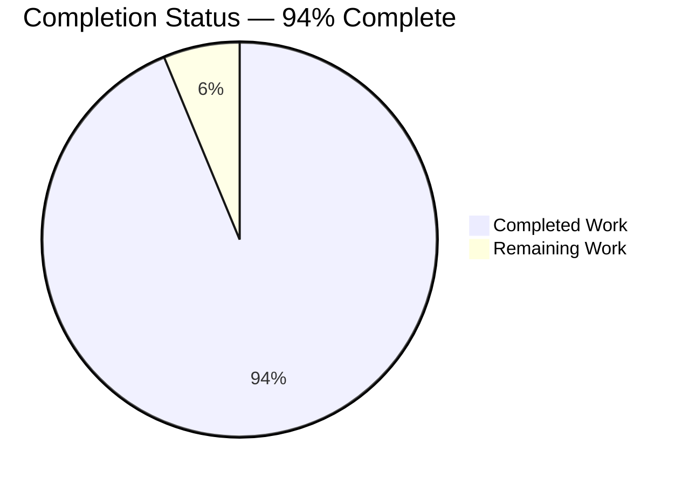
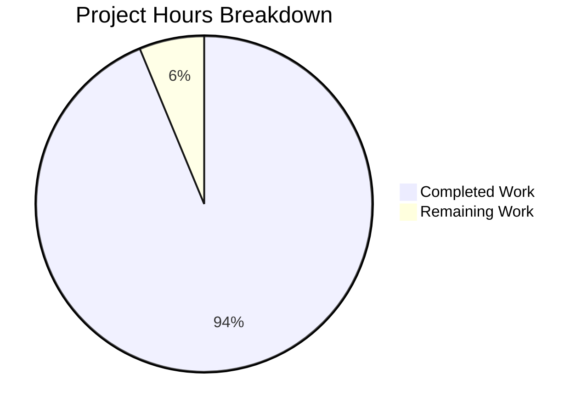

# 1. Executive Summary

## 1.1 Project Overview

Two committed files at the repository root, and nothing else: `hello_world.sh`, one POSIX shell statement writing `Welcome to Blitzy` to standard output unformatted, and `hello_world.txt`, a frozen fixture carrying that literal on exactly 98,000 newline-terminated lines. It serves the requesting stakeholder and any consumer needing an exact-count corpus or a minimal, dependency-free program. Both are byte-deterministic and provable by command output alone: 18 bytes on stdout, 1,764,000 bytes in the fixture, one distinct line, and no application, service, interface, build, dependency or configuration.

## 1.2 Completion Status



| Metric | Hours |
|--------|-------|
| Total Hours | 16 |
| Completed Hours (AI + Manual) | 15 |
| Remaining Hours | 1 |

Completion is measured over the Agent Action Plan's scope only: 15 completed hours ÷ 16 total hours = 93.75%, reported as **94% complete**. All 14 scoped requirements — D1–D5, FR1–FR4, NFR1–NFR4 — are delivered and verified; the remaining hour is release acceptance.

## 1.3 Key Accomplishments

- ✅ Program: 18 bytes on stdout — the greeting and one LF — one line, exit 0.
- ✅ Source: one line, 22 characters, 23 bytes; no shebang, comment, quoting or execute bit.
- ✅ Identical under sh, bash, dash, an empty environment, an unusable PATH and five locales.
- ✅ Fixture: 98,000 lines, 1,764,000 bytes, 1,666,000 literal bytes, one distinct line.
- ✅ Every line 17 bytes; no BOM, no carriage return, final line terminated.
- ✅ Both artefacts agree byte for byte at both corpus ends and both byte boundaries.
- ✅ Byte-deterministic: 20 sequential and 20 parallel runs give one identical hash.
- ✅ No generator, dependency, manifest, CI, container or configuration added.

## 1.4 Critical Unresolved Issues

**No unresolved issues identified.** 0 of the 5 request directives (D1–D5) and 0 of the 14 scoped requirements remain open. Six verification gaps could not be exercised here; none is a defect and none blocks release.

| Issue | Impact | Owner | ETA |
|-------|--------|-------|-----|
| Direct `./hello_world.sh` execution is not possible | None — the file carries no interpreter line and no execute bit by design | No action | n/a |
| No help, usage or argument-validation surface exists | None — the program consumes no arguments by design | No action | n/a |
| A write into a read-only directory was not exercised | Low — the runner is root, so permission checks are bypassed | Repository owner | On demand |
| No syscall-level proof that no file or socket is opened | Low — no tracing tool on the host; behavioural evidence stands in | Repository owner | On demand |
| Locales beyond C, POSIX and C.UTF-8 were not present | Low — output and counts matched in every available locale | Repository owner | On demand |
| No coverage figure exists | Low — the project ships no coverage tool and no test framework | Repository owner | On demand |

## 1.5 Access Issues

**No access issues identified.** The project reads no credential, calls no service and needs no permission beyond read access to its own files.

| System/Resource | Type of Access | Issue Description | Resolution Status | Owner |
|-----------------|----------------|-------------------|-------------------|-------|
| None | No access required | No credential, service, network resource or elevated permission is read or needed | Closed | — |

## 1.6 Recommended Next Steps

1. **[High]** Sign off the release candidate: re-run the documented invocation and the whole-package gate, confirming 18 bytes on stdout, 98,000 fixture lines and the pinned digests. (0.5h)
2. **[Medium]** Record the fixture's md5 and sha256, with the gate's assertions, in the release record outside the repository. (0.5h)
3. **[Low]** Pin the documented invocation `sh hello_world.sh` with any caller: there is no interpreter line and no execute bit.
4. **[Low]** Keep any re-worded greeting free of a leading dash and backslashes, or move to `printf '%s\n'`.

# 2. Project Hours Breakdown

## 2.1 Completed Work Detail

| Component | Hours | Description |
|-----------|-------|-------------|
| Greeting program — `hello_world.sh` (D1, D2 / FR1, FR2) | 4 | Selection of the smallest-footprint implementation by measured comparison of the one-line candidates, the single-statement source fixed at 1 line / 22 characters / 23 bytes, parser and byte-census review across dash and bash, and the runtime battery proving the 18-byte stdout contract. |
| Fixed-content fixture — `hello_world.txt` (D3, D5 / FR3) | 5 | Research of the exact-count writing idioms, the one-off single-process authoring of 98,000 lines, and verification of the byte layout property by property: count, size, literal bytes, terminators, distinct line, absence of BOM and carriage returns, and digest pinning. |
| Cross-artefact byte agreement (AAP 0.3.3) | 1 | Establishing, statically and at runtime, that the program's stdout is byte-identical to the fixture's first line, last line, first 18 bytes and final 18 bytes. |
| Verification battery (NFR1) | 3 | 80 executed command assertions across nine behaviour areas — contract, invocation, environment, inputs, output destinations, failure surface, determinism and concurrency, fixture content, fixture stability — plus the 19-row whole-package gate and the cross-artefact seam checks. |
| Repository delivery, structure and absence verification (D4, NFR2, NFR4) | 2 | Delivery of exactly two root files, the empty dependency inventory, the absence enumeration over every generator, build, CI, hook, test, container, configuration and scaffolding class, and the single pushed change commit. |
| **Total** | **15** | Sum of completed AAP-scoped work. |

## 2.2 Remaining Work Detail

| Category | Hours | Priority |
|----------|-------|----------|
| Release acceptance — sign off the frozen greeting and fixture against the documented invocation and the whole-package gate | 0.5 | High |
| Release record — pin the fixture's md5 and sha256 with the gate's assertions outside the repository so later drift is detectable | 0.5 | Medium |
| **Total** | **1** | |

No AAP deliverable remains unimplemented. The two items above are path-to-production acceptance work: the greeting, the fixture and their verification are complete, and what remains is a human confirming the frozen artefacts on the release candidate and recording their digests where a future change would be spotted.

# 3. Test Results

Every row below was executed against the delivered bytes at commit `7da8267`. The project ships no test framework, so the tests are command assertions judged by the value each command prints — the form the request's own specification prescribes. Coverage is not quantified because no coverage tool exists in this project.

| Area / Category | Framework | Tests | Passed | Failed | Coverage | What This Proves |
|-----------------|-----------|-------|--------|--------|----------|------------------|
| Program stdout contract and invocation (`hello_world.sh`) | Command assertions (POSIX sh + coreutils) | 13 | 13 | 0 | n/a — no coverage tool in project | The documented invocation writes exactly 18 bytes on one line, exits 0 with empty stderr, and the 1-line/23-byte source has no shebang and no execute bit. |
| Program environment, shell and locale independence | Command assertions | 12 | 12 | 0 | n/a | The output is byte-identical under sh, bash and dash, under an emptied environment, an unusable PATH, hostile IFS, five locales, an unrelated working directory, a symlink and a nested `sh -c`. |
| Program input and argument independence | Command assertions | 8 | 8 | 0 | n/a | Closed, empty, piped and 1.68 MB stdin are all ignored, and flag-like, hostile, traversal, glob and unicode arguments never change the 18 bytes written. |
| Output destinations and failure surface | Command assertions | 4 | 4 | 0 | n/a | File and append destinations carry the same 18 bytes, and an unwritable stdout exits non-zero with an explicit I/O error rather than failing silently. |
| Determinism, concurrency and side effects | Command assertions | 4 | 4 | 0 | n/a | 20 sequential and 20 parallel runs produce one identical hash, and repeated runs leave the working tree byte-for-byte unchanged. |
| Fixture content, count and byte shape (`hello_world.txt`) | Command assertions | 19 | 19 | 0 | n/a | 98,000 lines of exactly 17 bytes each, 1,764,000 bytes in total, 1,666,000 literal bytes, one distinct line, and no byte beyond the literal and LF anywhere in the file. |
| Fixture stability and immutability | Command assertions | 6 | 6 | 0 | n/a | The 98,000-line count is locale-independent, repeated reads are identical, and nothing that runs rewrites or adds to the tree. |
| Cross-artefact agreement and repository invariants | Command assertions | 14 | 14 | 0 | n/a | The program's stdout equals the fixture's bytes at both ends of the corpus, and the delivered set is exactly the two named files plus the untouched pre-existing README.md. |
| **Total** | | **80** | **80** | **0** | | |

The same battery was additionally exercised as a 19-assertion whole-package gate covering both artefacts — line and byte counts, distinct-line count, the `uniq` summary line, the anchored count, literal-byte count, first and last bytes, carriage-return count, a whole-file comparison against a freshly generated reference, the program's three output rows and the cross-artefact comparison. Every assertion returned its expected value.

**Not Covered**

- Nothing delivered is left unexercised behaviourally: every one of the 14 scoped requirements maps to an executed check above.
- Direct execution as `./hello_world.sh` — the file carries no interpreter line and no execute bit by design, so it must be invoked as `sh hello_world.sh`. A human should confirm that whichever job or harness runs the program uses that form.
- The help, usage and argument-validation surface — it does not exist by design, because the program consumes no arguments; nothing is missing.
- A write attempt into a read-only directory — the verification runner holds root, so permission checks are bypassed and the path cannot be exercised faithfully.
- Syscall-level confirmation that the program opens neither file nor socket — no tracing tool exists on this host; a run in a fixture-free directory with an unusable PATH stands in.
- Locale definitions other than C, POSIX and C.UTF-8 — they are not installed, so those names fall back silently; output and counts were identical in every available locale.
- Behaviour under an artificially low file-descriptor cap (`ulimit -n` 10 or less) — the shell cannot open any script file at that limit and exits 2; the same failure occurs for an unrelated control script, so it is a property of the interpreter and not of the program.
- Coverage measurement — the project deliberately ships no test framework and no coverage tool, so coverage is not quantified; a human's pre-release duty is limited to re-running the gate above on the release candidate.
- No browser, HTTP, service, database or user-interface surface exists in this project, so none could be exercised.

# 4. Runtime Validation & UI Verification

- ✅ **Start-up and documented invocation** — `sh hello_world.sh` from the repository root, from `/`, through a symlink and inside a nested `sh -c` each write exactly 18 bytes on one line and exit 0 with empty stderr.
- ✅ **Output byte fidelity** — stdout is `57 65 6c 63 6f 6d 65 20 74 6f 20 42 6c 69 74 7a 79 0a`, byte-identical to `printf 'Welcome to Blitzy\n'`, with no label, banner, padding or blank line.
- ✅ **Environment, shell and locale independence** — identical bytes under sh, bash and dash, under an emptied environment, an unset or unusable PATH, hostile IFS values, and under LC_ALL in C, POSIX, C.UTF-8, en_US.UTF-8 and tr_TR.UTF-8.
- ✅ **Input, argument and destination independence** — closed, empty, piped and 1.68 MB stdin are all ignored; flag-like, hostile, traversal, glob and unicode arguments change nothing; regular file, append and pipe destinations all carry the same 18 bytes.
- ⚠ **Failure surface** — with stdout closed or pointed at `/dev/full` the program exits 1 and writes `hello_world.sh: 1: echo: echo: I/O error` to stderr. This is correct behaviour, not a defect: the only failure path available fails loudly and never reports success.
- ✅ **Determinism, concurrency and idempotency** — 20 sequential and 20 parallel runs produce a single identical hash for stdout, and repeated runs leave both artefacts unchanged.
- ✅ **Fixture as data** — the whole 98,000-line corpus was read and compared against the program's line with zero mismatches, the file equals a freshly generated reference byte for byte, and its digests are unchanged after every run.
- ✅ **Cross-artefact integration** — the program's stdout compares equal to the fixture's first line, last line, first 18 bytes and final 18 bytes, each comparison exiting 0.
- ⚠ **Not applicable** — this project has no user interface, screen, HTTP endpoint, service, port or database, so no browser, console or network validation applies and none was performed.
- ⚠ **Never exercised at runtime** — direct `./hello_world.sh` execution (no interpreter line or execute bit by design), a write into a read-only directory (the runner holds root), syscall-level confirmation that no file or socket is opened (no tracing tool on the host), locale definitions that are not installed, and behaviour under a file-descriptor cap of 10 or less (an interpreter-level limit that fails loudly).

# 5. Compliance & Quality Review

## 5.1 Compliance Matrix

| # | Deliverable | Benchmark | Status | Progress |
|---|-------------|-----------|--------|----------|
| 1 | D1 / FR1 — the greeting printed to stdout with no formatting | Output fidelity, byte-exact | ✅ Pass | ██████████ 100% |
| 2 | D2 / FR2 — fewest lines, smallest footprint (1 line, 22 characters, 23 bytes) | Source-size discipline | ✅ Pass | ██████████ 100% |
| 3 | D3 / D5 / FR3 — the literal exactly 98,000 times in `hello_world.txt` | Content and count exactness | ✅ Pass | ██████████ 100% |
| 4 | D4 / FR4 — no script generates those lines | Committed-content integrity | ✅ Pass | ██████████ 100% |
| 5 | NFR1 — verification by command output rather than assertion | Evidence-based acceptance | ✅ Pass | ██████████ 100% |
| 6 | NFR2 — no package, manifest or runtime beyond a POSIX toolchain | Dependency hygiene | ✅ Pass | ██████████ 100% |
| 7 | NFR3 — byte determinism: LF only, ASCII, no BOM, no CR | Reproducible output | ✅ Pass | ██████████ 100% |
| 8 | NFR4 — minimality: no configuration, documentation, CI or scaffolding added | Scope discipline | ✅ Pass | ██████████ 100% |
| 9 | Delivery set — exactly the two named files at the repository root | Repository structure | ✅ Pass | ██████████ 100% |
| 10 | Cross-artefact contract — the program's stdout equals one fixture line | Internal consistency | ✅ Pass | ██████████ 100% |
| 11 | Security baseline — no secret, no input surface, no injection sink, no privilege | Security hygiene | ✅ Pass | ██████████ 100% |
| 12 | Code quality — POSIX conformance, no placeholder, no TODO/FIXME, no dead or commented-out code | Maintainability | ✅ Pass | ██████████ 100% |

## 5.2 AAP & Rule Divergences and Gaps

Four divergences are on record. Two were required by the request's own directives and are marked **Sanctioned**; the other two are inaccuracies in the plan's own text with no effect on the delivered code. No user-specified rules were provided for this project, so no rule was departed from beyond the general-practice deviations the brevity directive mandates.

| # | What the AAP/Rule Required | What Was Delivered Instead | Why It Diverged | Impact | Remediation |
|---|---------------------------|----------------------------|-----------------|--------|-------------|
| 1 | Usual shell-script convention: interpreter line plus a documenting header comment | One line, `echo Welcome to Blitzy` — no shebang, no comment, no quoting, no execute bit (`hello_world.sh:1`) | **Sanctioned** by the request's own brevity directive, which the plan makes the governing constraint and which fixes the file at one line and 23 bytes | Reader sees no rationale inside the file; the program must be invoked as `sh hello_world.sh` | None — the form is the acceptance criterion; do not restore the header |
| 2 | Common practice: do not commit large generated content, keeping a generator able to rebuild it | The 1,764,000-byte fixture is committed in full as frozen content, with no regeneration path anywhere | **Sanctioned** — the request forbids any script that generates those lines, which removes the only mechanism that could rebuild the file | No in-repository regeneration or drift detection; any wording or count change re-authors all 98,000 lines by hand | Keep the file frozen and pin its digests in the release record |
| 3 | The plan's premise that the working copy was empty, so both named files would be creations | Both named files are creations, and the tree also carries a pre-existing `README.md` (39 bytes, base blob `71313e5b…`, byte-identical and untouched) | Not implemented in this run — the pre-existing file was outside the delivery's scope, and neither editing nor deleting it was authorised | None on any deliverable: the requirement is that nothing be *added* around the artefacts, and nothing was | None — do not treat the tree's third file as delivered work |
| 4 | The plan's environment note that `file(1)` is absent from this environment | `/usr/bin/file` is present on this host; `xxd` is absent as stated | Not implemented in this run — an environment claim no change to the code could settle | None: byte inspection uses `od -An` throughout and produced every byte-level verdict | None — do not rely on the note as a tool inventory |

**Divergence 1 — the one-line source with no header (Sanctioned).** The request's own instruction to use as few lines as possible governs this file, and the specification fixes its content byte-for-byte at one line and 23 bytes (`hello_world.sh:1`). Every omission follows from that: a shebang would make the source two lines, a comment or header would enlarge it, quoting the operand would add two characters for no change in output, and an execute bit is unnecessary because the documented invocation is `sh hello_world.sh`. The practical consequence is that the file looks unconventional in isolation and must not be "corrected" by restoring the customary script header — doing so would breach the fixed content. The rationale is written down here rather than inside the file, because a comment there would itself breach the deliverable.

**Divergence 2 — the fixture committed as frozen content (Sanctioned).** Repository convention discourages committing large generated content, on the assumption that a checked-in generator can rebuild it. Here the request forbids any script that generates those lines, which removes the only mechanism that could rebuild the file, so the 1,764,000-byte fixture ships as the deliverable itself (blob `6488549a…` in commit `7da8267`). The trade-off the reader inherits is that nothing inside the repository can regenerate or re-verify it: a wording or count change means re-authoring all 98,000 lines and re-proving them, and the only drift guard is the pinned md5 `6a7b6cc28b22ba8a001170b38b6fa8ba` and sha256 `8a62b696cbe4c00907f52b0a9162e3bcdf5b8d01db118cc12175db99bbace3fa`. Recording those digests in the release record is the intended mitigation.

**Divergence 3 — the tree is not empty, and was not before this work.** The plan assumes an empty working copy so that both named files are creations. The repository also carries `README.md`: 39 bytes, added by the base commit, blob `71313e5b633fbea202cfe648baed1da8b2c32b7f`, byte-identical before and after this work and never in scope. Nothing about the delivery is affected — the requirement is that no configuration, documentation, CI or scaffolding be *added* around the artefacts, and nothing was; both named files are genuine additions. The reader should simply not expect the tree to hold only two files, and should leave the third alone.

**Divergence 4 — the plan's tool inventory is outdated.** The plan's background notes state that `file(1)` is absent from the environment, and the delivered work assumed nothing less: byte inspection uses `od -An` throughout, which is present and produced every byte-level verdict (`head -c 3 | od -An -tx1` giving ` 57 65 6c`, `tail -c 1` giving ` 0a`). On this host `/usr/bin/file` is in fact present, while `xxd` is absent as stated. No deliverable value depends on the claim and no repository file repeats it, so nothing needs changing; it is recorded only so a reader auditing the verification commands does not treat the note as an authoritative tool inventory.

# 6. Risk Assessment

| Risk | Category | Severity | Probability | Mitigation | Status |
|------|----------|----------|-------------|------------|--------|
| The frozen fixture can drift with nothing inside the repository able to detect it | Technical / Operational | Medium | Low | Pin md5 `6a7b6cc28b22ba8a001170b38b6fa8ba` and sha256 `8a62b696cbe4c00907f52b0a9162e3bcdf5b8d01db118cc12175db99bbace3fa` in the release record and re-run the whole-package gate on any change | Accepted — the request forbids any in-repository generator or check, so the guard lives in the release process |
| The program's literal and the fixture's line can silently disagree if either is edited alone | Technical | Medium | Low | Edit both artefacts together and assert `cmp <(sh hello_world.sh) <(head -n 1 hello_world.txt)` before committing | Accepted — the agreement is conventional rather than enforced by the tree |
| A caller that runs `./hello_world.sh` fails immediately | Integration / Operational | Medium | Medium | Pin the documented invocation `sh hello_world.sh` in any job, harness or note that runs the program | Mitigated by documentation — the file carries no interpreter line and no execute bit by design |
| Terminal capture turns the trailing LF into CRLF | Integration | Low | Medium | Compare output through pipes, files or FIFOs, or disable the terminal's ONLCR discipline, before byte-comparing captured output | Known, environmental — the translation is the kernel line discipline, not the program |
| A runner with a file-descriptor cap of 10 or less cannot execute any shell script | Operational | Low | Low | Require a descriptor limit of at least 12; the failure is loud (exit 2) rather than silent | Known, environmental — an unrelated control script fails identically |
| The shell's implementation-defined `echo` behaviour becomes reachable if the greeting is ever re-worded | Technical | Low | Low | Keep the literal free of a leading dash and of backslashes, or move to `printf '%s\n'` | Prevented by the fixed content today; revisit if the text changes |
| Assurance depends on command output alone, with no coverage, static-analysis or tracing tooling | Technical | Low | Medium | Re-run the documented command set after any change; obtain tracing on a host that provides it if deeper proof is wanted | Accepted — the project ships no such tooling by design |

No severity above Medium is present: neither artefact reads input, opens a network connection, holds a credential or requests privilege, and the delivered tree contains no dependency whose advisories would need tracking. The risks above are all consequences of the two properties the request deliberately chose — a fixed one-line program and a frozen, non-regenerable data file — and each is addressable outside the repository without changing the delivered content.

# 7. Visual Project Status



**Requirement status — 14 of 14 scoped requirements complete**

| Status | Requirements | Share |
|--------|--------------|-------|
| Completed | 14 | 100% |
| Partially Completed | 0 | 0% |
| Not Started | 0 | 0% |

**Remaining hours by category**

| Category | Hours | Priority |
|----------|-------|----------|
| Release acceptance of the frozen greeting and fixture | 0.5 | High |
| Release record — pin the fixture's digests and the gate's assertions outside the repository | 0.5 | Medium |
| **Total** | **1** | |

The completed work sits in five areas — the greeting program (4h), the fixed-content fixture (5h), the cross-artefact byte agreement (1h), the verification battery (3h) and repository delivery with structure and absence verification (2h) — and every one of the 14 scoped requirements is delivered and verified. All remaining effort is release acceptance: no engineering work is outstanding on either artefact.

# 8. Summary & Recommendations

This project delivers exactly what was asked for, in exactly two files. `hello_world.sh` is a single POSIX shell statement that writes the greeting `Welcome to Blitzy` to standard output unformatted — 18 bytes, one line, exit status 0, empty stderr. `hello_world.txt` is a frozen data fixture carrying the same literal on exactly 98,000 newline-terminated lines — 1,764,000 bytes, one distinct line, no BOM, no carriage return, no byte anywhere in the file beyond the literal and its terminators. Both sit at the repository root, both are committed, and no dependency, manifest, build step, CI workflow, container, configuration or test file was added around them.

What was verified is as concrete as the artefacts themselves. Eighty executed command assertions across nine behaviour areas, plus a 19-assertion whole-package gate, all returned their expected values: the program writes the same 18 bytes under sh, bash and dash, an emptied environment, an unusable PATH, hostile IFS and five locales, ignores every argument and every stdin condition it was given, and survives 20 sequential and 20 parallel runs with a single identical hash. The fixture was read whole and compared line by line against the program's output with zero mismatches, matched byte for byte against a freshly generated reference, and left unchanged by everything that ran. The two artefacts agree at both ends of the corpus and at both byte boundaries. Against the Agent Action Plan's scope, 15 of 16 estimated hours are complete — **94% complete** — and all 14 scoped requirements are delivered and verified.

Nothing blocks release. No defect is open in the branch, and the six checks that could not be exercised here are limits of the environment rather than of the work: direct `./hello_world.sh` execution (not the documented invocation), a help or usage surface (none exists by design), a write into a read-only directory (the runner holds root), syscall-level tracing of file access (no tracing tool on the host), locale definitions that are not installed, and a file-descriptor cap of 10 or less (an interpreter-level limit that fails loudly). The critical path to production is short: sign off the frozen artefacts against the documented invocation and the gate, then record the fixture's md5 `6a7b6cc28b22ba8a001170b38b6fa8ba` and sha256 `8a62b696cbe4c00907f52b0a9162e3bcdf5b8d01db118cc12175db99bbace3fa` together with the gate's assertions in the release record so any later drift is detectable. Both items together are one hour, and both belong outside the repository, which the request requires to stay free of any generating script or check.

Two consequences of the design deserve the reader's attention before the code is touched again. The fixture has no regeneration path by design, so a change to the greeting text or the repetition count means re-authoring all 98,000 lines with the documented command and re-proving every count and digest by hand — and the program and the fixture must then be updated together, because their agreement is a convention the repository does not enforce. And the program must always be invoked as `sh hello_world.sh`: it carries neither an interpreter line nor an execute bit, so any job or harness that calls it directly will fail.

**Production readiness: ready as written.** The deliverable is byte-deterministic, dependency-free, privilege-free, free of any input surface, error path or attack surface, and its contract — 18 bytes on stdout, exit status 0, a 1,764,000-byte fixture of 98,000 identical lines — is proven by observed command output rather than asserted. The success metrics to carry into release are the five fixed values: 18 bytes on stdout, 1 line on stdout, exit status 0, 98,000 lines in the fixture and 1,764,000 bytes in the fixture, with the md5 and sha256 above as the drift guard.

# 9. Development Guide

**System Prerequisites**

A POSIX shell and the standard coreutils. Nothing else is required — there is no compiler, interpreter install, package manager, manifest, lock file, service, port, database, broker, credential or environment variable.

```bash
readlink -f /bin/sh          # /usr/bin/dash      — the shell this project is verified against
awk --version | head -1      # mawk 1.3.4         — used only for the one-off authoring command
command -v od cmp md5sum sha256sum wc sort uniq grep head tail tr
```

`xxd` is not installed; use `od` for byte inspection. bash works equally well as the interpreter if `/bin/sh` is not dash on your host.

**Environment Setup and Dependency Installation**

There is none. No virtual environment, no `.env`, no settings file, no build step, no migration and no service to start. The repository declares no dependency, so there is nothing to install or pin. Work from the repository root:

```bash
cd /path/to/98k-lines-511d0ab5
```

**Reproducing the Fixture's Content (one-off authoring)**

`hello_world.txt` is committed content, not a build output: nothing in the repository generates or rewrites it, by design. The single command that produced it, should the content ever need re-authoring, is:

```bash
awk 'BEGIN{for(i=0;i<98000;i++) print "Welcome to Blitzy"}' > hello_world.txt
```

Do not run this as a routine step. It is the only way to rebuild the file, it must never be committed as a script, and it belongs outside any CI, hook or test. Verified without touching the committed file by writing to a scratch path and comparing: the command exits 0 and `cmp` against the committed fixture exits 0.

**Running the Program**

```bash
sh hello_world.sh
# Welcome to Blitzy
```

Always invoke the file as `sh hello_world.sh`. It deliberately carries no interpreter line and no execute bit, so `./hello_world.sh` fails.

**Verification**

Each command below was executed against the delivered artefacts and prints the value shown.

```bash
sh -n hello_world.sh                            # exit 0 — valid POSIX shell
sh hello_world.sh | wc -c                       # 18
sh hello_world.sh | wc -l                       # 1
sh hello_world.sh | od -An -tx1                 #  57 65 6c 63 6f 6d 65 20 74 6f 20 42 6c 69 74 7a 79 0a
wc -l < hello_world.txt                         # 98000
wc -c < hello_world.txt                         # 1764000
tr -d '\n' < hello_world.txt | wc -c            # 1666000
sort -u hello_world.txt | wc -l                 # 1
uniq -c hello_world.txt                         #   98000 Welcome to Blitzy
grep -c '^Welcome to Blitzy$' hello_world.txt   # 98000
head -c 3 hello_world.txt | od -An -tx1         #  57 65 6c   (no byte-order mark)
tail -c 1 hello_world.txt | od -An -tx1         #  0a         (final line terminated)
md5sum hello_world.txt | cut -d' ' -f1          # 6a7b6cc28b22ba8a001170b38b6fa8ba
sha256sum hello_world.txt | cut -d' ' -f1       # 8a62b696cbe4c00907f52b0a9162e3bcdf5b8d01db118cc12175db99bbace3fa
LC_ALL=C grep -c "$(printf '\r')" hello_world.txt   # prints 0 and exits 1 — no carriage returns
awk 'BEGIN{for(i=0;i<98000;i++) print "Welcome to Blitzy"}' | cmp - hello_world.txt   # exit 0
cmp <(sh hello_world.sh) <(head -n 1 hello_world.txt)   # exit 0 — stdout equals one fixture line
git status --porcelain | wc -l                  # 0 — nothing that ran modified the tree
```

Judge these by the value each prints. This host's bash runs with `set -o pipefail` enabled, so a pipeline can report a non-zero status while printing the correct value — `sh hello_world.sh | wc -c` printing `18` is the proof, not the pipeline's exit code. The carriage-return row deliberately uses `"$(printf '\r')"` rather than bash's `$'\r'` quoting, which prints `0` even on a file that does contain carriage returns when run under dash.

**Example Usage**

```bash
line=$(sh hello_world.sh); printf '[%s]\n' "$line"       # [Welcome to Blitzy]

diff <(sh hello_world.sh) <(head -n 1 hello_world.txt) \
  && echo "stdout matches fixture line 1"

cmp -s <(sh hello_world.sh) <(tail -n 1 hello_world.txt) \
  && echo "stdout matches fixture line 98000"
```

**Troubleshooting**

| Symptom | Cause | Resolution |
|---------|-------|------------|
| `./hello_world.sh: Permission denied` (exit 126) | The file carries no interpreter line and no execute bit, by design | Invoke it as `sh hello_world.sh` |
| `hello_world.sh: 1: echo: echo: I/O error`, exit 1 | stdout is closed or unwritable (for example `>&-` or `/dev/full`) | Redirect stdout to a writable destination; the failure is loud by design and never exits 0 |
| Terminal output shows `Welcome to Blitzy\r\n` | The terminal's ONLCR line discipline translates the trailing LF | Compare output through a pipe or a file, or disable ONLCR; pipes, files and FIFOs carry the LF alone |
| A pipeline reports status 141 although the bytes are correct | This shell has `pipefail` enabled, so the first failing stage governs the pipeline | Judge the printed value (`wc -c` = 18) or `cmp`'s own status, not the pipeline's exit status |
| `sh: 0: 3: Invalid argument`, exit 2 | The shell's file-descriptor limit is 10 or less, so the interpreter cannot open any script file | Raise the descriptor limit to at least 12; the failure is loud, and an unrelated script fails identically |
| `wc -l` reports a count other than 98000 | The fixture was modified, truncated or re-wrapped | Re-author it with the command above and re-run the verification block, including the md5 and sha256 rows |

# 10. Appendices

**A. Command Reference**

| Command | Purpose | Expected result |
|---------|---------|-----------------|
| `sh hello_world.sh` | Run the program | `Welcome to Blitzy` |
| `sh -n hello_world.sh` | Parse the program without running it | exit 0 |
| `sh hello_world.sh \| wc -c` | stdout size | `18` |
| `sh hello_world.sh \| wc -l` | stdout line count | `1` |
| `sh hello_world.sh \| od -An -tx1` | stdout bytes | `57 65 6c 63 6f 6d 65 20 74 6f 20 42 6c 69 74 7a 79 0a` |
| `wc -l < hello_world.txt` | Fixture line count | `98000` |
| `wc -c < hello_world.txt` | Fixture size | `1764000` |
| `tr -d '\n' < hello_world.txt \| wc -c` | Fixture literal bytes only | `1666000` |
| `sort -u hello_world.txt \| wc -l` | Distinct lines | `1` |
| `uniq -c hello_world.txt` | Repetition summary | `  98000 Welcome to Blitzy` |
| `grep -c '^Welcome to Blitzy$' hello_world.txt` | Anchored line count | `98000` |
| `head -c 3 hello_world.txt \| od -An -tx1` | First bytes (BOM check) | ` 57 65 6c` |
| `tail -c 1 hello_world.txt \| od -An -tx1` | Final byte (terminator check) | ` 0a` |
| `LC_ALL=C grep -c "$(printf '\r')" hello_world.txt` | Carriage-return check | prints `0`, exits 1 |
| `md5sum hello_world.txt` | Digest | `6a7b6cc28b22ba8a001170b38b6fa8ba` |
| `sha256sum hello_world.txt` | Digest | `8a62b696cbe4c00907f52b0a9162e3bcdf5b8d01db118cc12175db99bbace3fa` |
| `awk 'BEGIN{for(i=0;i<98000;i++) print "Welcome to Blitzy"}' \| cmp - hello_world.txt` | Whole-file equality against a fresh reference | exit 0, no output |
| `cmp <(sh hello_world.sh) <(head -n 1 hello_world.txt)` | Cross-artefact agreement | exit 0 |

**B. Port Reference**

None. The project opens no socket, starts no service and listens on no port.

| Service | Port | Notes |
|---------|------|-------|
| — | — | No listener exists anywhere in this project |

**C. Key File Locations**

| Path | Purpose |
|------|---------|
| `hello_world.sh` | The whole program: one POSIX shell statement, 1 line, 23 bytes |
| `hello_world.txt` | The frozen fixture: 98,000 lines, 1,764,000 bytes |
| `README.md` | Pre-existing repository readme, unrelated to the delivery and untouched |

**D. Technology Versions**

| Component | Version on the verification host | Notes |
|-----------|----------------------------------|-------|
| POSIX shell (`/bin/sh`) | dash 0.5.12 | The documented interpreter; bash 5.2.37 also runs the program identically |
| awk | mawk 1.3.4 | Used only for the one-off authoring command and verification rows |
| Coreutils | `od`, `cmp`, `wc`, `sort`, `uniq`, `grep`, `head`, `tail`, `tr`, `md5sum`, `sha256sum` | Standard POSIX/GNU utilities; no version is pinned because nothing is declared as a dependency |
| `xxd` | not installed | Use `od -An` for byte inspection |

**E. Environment Variable Reference**

None. Neither artefact reads an environment variable, a configuration value, a secret or a credential. The program produces identical output under `env -i`, with `PATH` unset, with an unusable `PATH`, with a hostile `IFS`, and under every available locale.

**F. Developer Tools Guide**

| Concern | Guidance |
|---------|----------|
| Interpreter | Use `sh hello_world.sh`. No shebang or execute bit is present by design, so direct execution is not supported. |
| Byte inspection | Use `od -An -tx1` (`xxd` is unavailable). Note that `od` wraps its output every 16 bytes. |
| Pipeline status | This host's bash enables `pipefail`, so a pipeline's status can be non-zero even when its output is correct — assert on values. |
| Portable carriage-return check | Use `grep -c "$(printf '\r')"` rather than bash-only `$'\r'` quoting, which gives a false pass under dash. |
| Terminal capture | Expect `\r\n` through a pty because of the kernel ONLCR discipline; compare through pipes or files instead. |
| Descriptor limits | Keep the runner's `ulimit -n` at 12 or above; below that the interpreter cannot open any script file. |
| Fixture changes | Re-author with the documented command and re-run the whole verification block, including both digests; never add a generator, CI step or hook to the repository. |

**G. Glossary**

| Term | Meaning |
|------|---------|
| Fixture | `hello_world.txt`, the committed 98,000-line data file that carries the greeting |
| Verbatim | The literal `Welcome to Blitzy`, 17 bytes, with capital `W` and `B` and single spaces |
| LF | Line feed (`0x0a`), the line terminator used on every line including the last |
| Terminated final line | The file ends with the newline of line 98,000 rather than an unterminated run of characters |
| Byte-deterministic | The same bytes are produced on every run, in every shell, locale and environment |
| Cross-artefact agreement | The property that the program's 18-byte stdout equals one line of the fixture, byte for byte |
| ONLCR | The terminal line discipline that translates a written LF into CR+LF on a pty |
| `pipefail` | A shell option making a pipeline report its first failing stage rather than its last |
